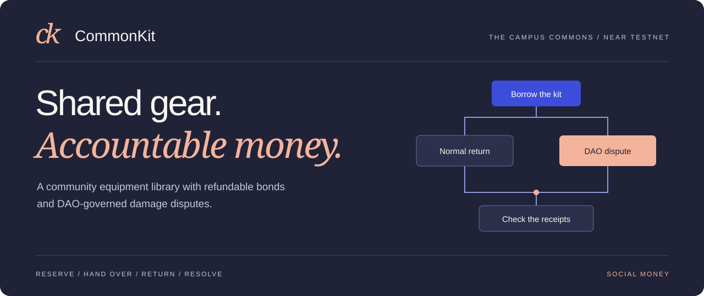
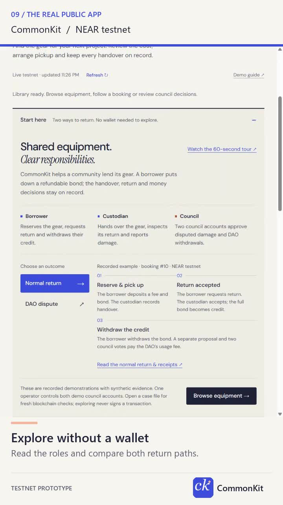
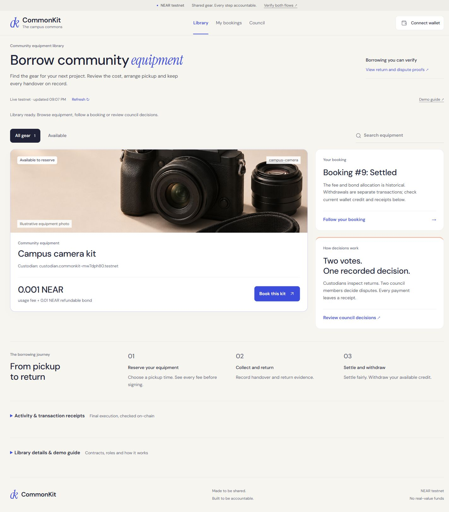
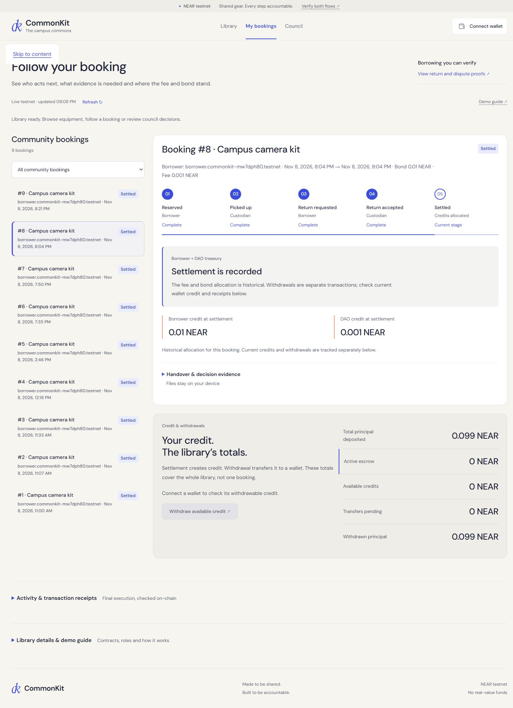
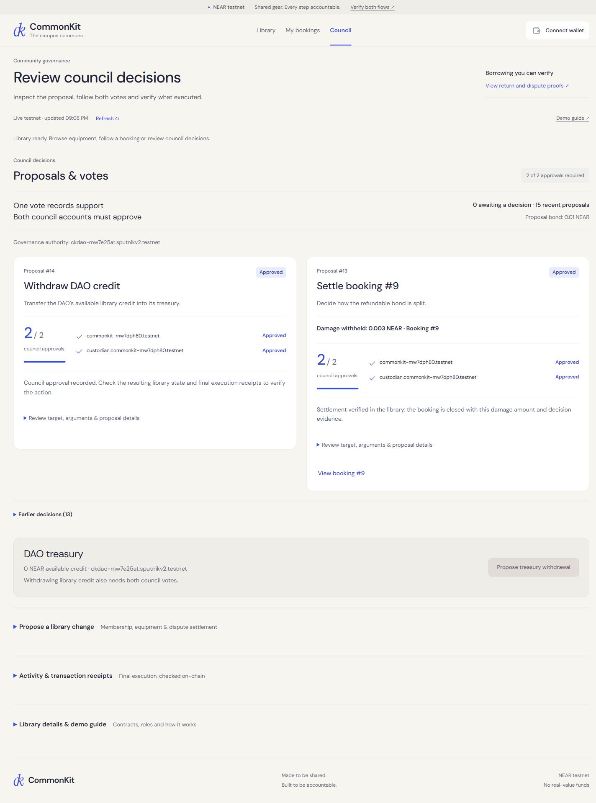
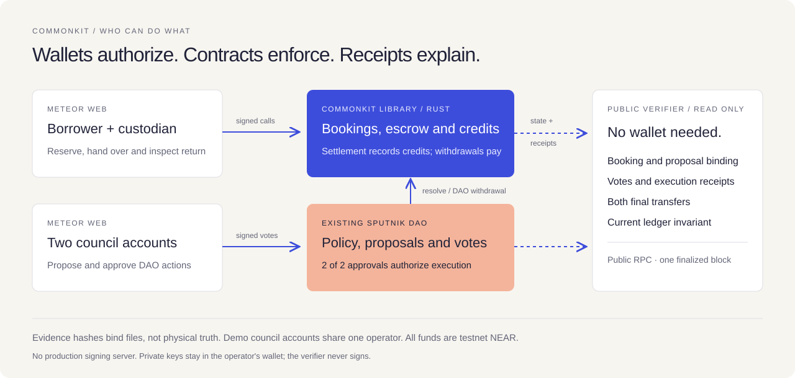

<p align="center">
  <a href="https://commonkit-testnet.vercel.app"></a>
</p>

<h1 align="center">CommonKit</h1>
<p align="center"><strong>A community equipment library with refundable bonds and DAO-governed disputes.</strong><br>Reserve the gear. Record the handover. Follow every decision and payment.</p>
<p align="center"><strong>NEAR testnet</strong> &nbsp; / &nbsp; Social Money &nbsp; / &nbsp; Sputnik DAO &nbsp; / &nbsp; Meteor Web &nbsp; / &nbsp; MIT</p>
<p align="center">
  <a href="https://commonkit-testnet.vercel.app"><strong>Open the library ↗</strong></a> &nbsp; · &nbsp;
  <a href="https://commonkit-testnet.vercel.app/judge.html"><strong>60-second judge tour ↗</strong></a> &nbsp; · &nbsp;
  <a href="https://commonkit-testnet.vercel.app/verify.html"><strong>Verify both flows ↗</strong></a>
</p>
<p align="center"><a href="#why-commonkit">Why CommonKit</a> · <a href="#in-action">In action</a> · <a href="#follow-the-money">The money</a> · <a href="#for-judges">For judges</a> · <a href="#run-locally">Run locally</a> · <a href="#scope-and-trust">Scope & trust</a></p>

> **Release status:** working testnet prototype, publicly hosted on Vercel. Both fresh Meteor flows passed on the public origin on 9 November: **19 finalized transactions, 48 receipt checks, both payouts complete**. The owner handled wallet approvals while the app and public verifier checked execution. Booking #13 adds a real Meteor reservation initiated from a 390 × 844 review, with six additional public checks (54 total). It is not a completed return or physical-phone test. The repository was made public for judging on 14 November 2026. [Latest receipts](docs/testnet/vercel/README.md) · [Deployment record](docs/VERCEL.md).

## Why CommonKit

A campus club has one camera and many people who need it. Booking it is easy. Keeping track of who collected it, whether it came back damaged, and who should receive the deposit is harder.

CommonKit makes that process inspectable. A borrower locks a refundable bond. A separate custodian records handover and inspects the return. If they disagree, the community's existing Sputnik DAO authorizes a damage allocation through two council approvals. The borrower and DAO then withdraw their credits, leaving public execution receipts.

**The first audience is campus clubs and small equipment-sharing communities.** The camera kit is the current demo asset; no real-world adoption or pilot results are claimed.

| The community needs | CommonKit provides |
| --- | --- |
| Clear borrowing terms | Availability, fee, refundable bond and retained storage shown before signing |
| An accountable handover | Distinct borrower/custodian permissions and evidence hashes at pickup and return |
| A way to handle disagreement | A DAO proposal binding the booking, damage amount and decision evidence |
| A checkable payment history | Separate settlement and withdrawal states, final receipt checks and a public verifier |

## Try it in one minute

**No wallet is needed for this judge path.** Start with [both recorded outcomes](https://commonkit-testnet.vercel.app/recorded.html): dated evidence and payout links, readable without JavaScript or RPC. The [1:55 pitch and real app walkthrough](https://commonkit-testnet.vercel.app/film.html) shows the camera story using recorded product captures. The illustrated tour explains the examples; the separate verifier performs fresh RPC reads.

New here? Open the library's **Start here** guide to learn the three roles and compare both outcomes. Browse equipment and inspect its quote before connecting Meteor. [Visitor and borrowing paths](docs/ONBOARDING.md).

| Time | Do this | See this |
| --- | --- | --- |
| 0–10s | Open the [judge tour](https://commonkit-testnet.vercel.app/judge.html) | The camera, the three roles and the borrowing journey |
| 10–20s | Select **Reserve** | Mobile-width reservation #13; 0.111 testnet NEAR attached: 0.011 principal plus 0.100 retained storage |
| 20–30s | Select **Normal return** | Booking #10: the borrower receives the full 0.010 bond; the DAO receives the 0.001 fee |
| 30–40s | Select **First vote** | The saved booking #11 checkpoint: one approval, 0.011 still escrowed, zero credits |
| 40–50s | Select **Settlement** | Second approval authorizes 0.003 damage; credits and actual withdrawals remain distinct |
| 50–60s | Select **Verify it**, then open a proof | 21 normal-return, 27 dispute or 6 mobile-reservation checks, receipts and a downloadable report |

When RPC is unavailable, the [recorded-proof page](https://commonkit-testnet.vercel.app/recorded.html) stays readable. It is generated from the published manifests and snapshots, never used as a current PASS. RPC completion time is additional to the tour. A mismatch or unavailable receipt is reported; saved snapshots never substitute for a live pass. [Verification scope](docs/VERIFICATION.md) · [Narration and evidence map](docs/JUDGE-WALKTHROUGH.md).

To run a **new signed cycle**, use [the Meteor wallet guide](https://commonkit-testnet.vercel.app/demo-guide.html). Only DAO-admitted members can borrow; only authorized council accounts can vote. Public visitors can inspect both flows without our wallet accounts.

## Watch the final demo

[Published hackathon demo on X](https://x.com/Muthu__kumaran_/status/2121671752900374570) · built at NEAR HACKATHON.

<a href="https://commonkit-testnet.vercel.app/film.html"></a>

**1:55 · English voiceover and captions.** [Watch the film](https://commonkit-testnet.vercel.app/film.html) · [Download the MP4](https://commonkit-testnet.vercel.app/media/commonkit-final-2026-11-14.mp4). The real app walkthrough starts at 0:50. The 54-check count is a dated 14 November result, including the separate mobile reservation. [Media credits](app/public/media/CREDITS.md).

## In action

### Find the kit. Understand the terms.

<a href="https://commonkit-testnet.vercel.app"></a>

<table>
<tr>
<td width="50%" valign="top"><br><strong>A return you can follow.</strong><br>See the next actor, evidence and allocation in one booking view.</td>
<td width="50%" valign="top"><br><strong>A decision you can inspect.</strong><br>Read the target, both votes and the resulting library state.</td>
</tr>
</table>

<sub>Product captures from the local production preview on 8 November 2026, reading public testnet state. These screenshots are not new Vercel wallet receipts. The camera image is illustrative; displayed state can change. [Capture context](docs/testnet/unslop/README.md).</sub>

## Follow the money

**One camera booking attaches 0.111 testnet NEAR.** Of that, 0.100 is retained storage and 0.011 is tracked principal: a 0.010 bond plus a 0.001 usage fee. Gas and the separate 0.010 DAO proposal bond are outside this principal ledger.

| Recorded outcome | Borrower withdrawal | DAO withdrawal | Evidence |
| --- | --- | --- | --- |
| Normal return, zero damage | **0.010 NEAR** | **0.001 NEAR** fee | [Booking #10 · 8 transactions](https://commonkit-testnet.vercel.app/verify.html?flow=normal) |
| Dispute, 0.003 damage | **0.007 NEAR** | **0.004 NEAR** fee + damage | [Booking #11 · 11 transactions](https://commonkit-testnet.vercel.app/verify.html?flow=dispute) |

The custodian accepts a normal return. A disputed return requires two council approvals. **One vote leaves the principal escrowed; settlement creates credits, and withdrawals transfer the money.** The DAO's own withdrawal requires a separate two-vote treasury proposal in either flow.

```text
deposited principal = escrow + available credits + pending transfers + withdrawn principal
```

The verifier independently recomputes the current whole-library ledger at one finalized block. Later bookings can change those totals without changing historical receipts. [Saved one-vote checkpoint](app/public/verification/vercel/dispute/single-vote.json) · [Normal-return manifest](app/public/verification/vercel/normal/manifest.json) · [Dispute manifest](app/public/verification/vercel/dispute/manifest.json).

Read the [dispute case file](https://commonkit-testnet.vercel.app/verify.html?flow=dispute#case-file) to compare the original damage report with the council decision, inspect both votes and locally match evidence files. [How file matching works](docs/CASE-FILE.md).

## Architecture



| Existing infrastructure | CommonKit's application logic |
| --- | --- |
| **Sputnik DAO:** council membership, proposal policy, votes and approved FunctionCall execution | **Rust library contract:** member admission, equipment reservations, custody, return/dispute states, bond allocation and retryable withdrawals |
| **Meteor Web + NEAR Connect:** browser wallet identities and signing | **Frontend:** role-aware controls, booking review, progress and final execution checks |
| **NEAR:** account identities, contract execution and asynchronous receipts | **Public verifier:** expected call binding, child receipt outcomes, both payments and recomputed accounting |

The library holds booking principal. Sputnik authorizes disputed allocation; it does not replace the library's state machine. There is no hosted signing backend in the production frontend.

| Deployment | Public testnet account |
| --- | --- |
| Library | [`library.ckdao-mw7e25at.testnet`](https://testnet.nearblocks.io/address/library.ckdao-mw7e25at.testnet) |
| Sputnik DAO | [`ckdao-mw7e25at.sputnikv2.testnet`](https://testnet.nearblocks.io/address/ckdao-mw7e25at.sputnikv2.testnet) |

[All public account IDs](app/public/deployment.json) · [Recorded Wasm hash](docs/VALIDATION.json) · [Contract source](contract/src/lib.rs) · [Shared state machine](core/src/lib.rs).

## For judges

| What to assess | Where to look | Evidence boundary |
| --- | --- | --- |
| The complete borrowing lifecycle | [Vercel normal return #10](docs/testnet/vercel/README.md) and [DAO dispute #11](docs/testnet/vercel/desktop-dispute/manifest.json) | 8 and 11 finalized testnet transactions; synthetic equipment evidence |
| Real collective authorization | [One-vote checkpoint](app/public/verification/vercel/dispute/single-vote.json), [settlement checkpoint](app/public/verification/vercel/dispute/settled.json) and [frontend governance actions](app/app.js) | Two distinct council accounts, both controlled by the demo operator |
| Mobile-width reservation | [Booking #13 public proof](https://commonkit-testnet.vercel.app/verify.html#mobile-proof), [capture record](docs/testnet/mobile-booking-2026-11-12/README.md) | 390 × 844 review and signature initiation, real Meteor approval; later desktop confirmation. Reservation only, not a physical-phone test |
| Receipt and accounting correctness | [Browser verifier](https://commonkit-testnet.vercel.app/verify.html), `npm run verify:testnet`, [verification engine](app/public/verification/engine.js) | 48 checks across the two completed Vercel flows plus 6 for mobile reservation #13; read-only, not a new signing rehearsal |
| Failure behavior | [Compiled-contract sandbox suite](docs/CONTRACT-FAILURE-TESTS.md) | 19 targeted cases: authorization, rollback, failed transfers/retry, callback replay and DAO execution failure |
| Browser integration | [Four cobalt UI rehearsals](docs/testnet/cobalt/README.md) | 38 transactions and 96 checks across desktop/responsive normal + dispute cycles; not physical-phone validation |
| Current public deployment | [Vercel Meteor rehearsals](docs/testnet/vercel/README.md) | Booking #10 normal return and #11 dispute; 19 finalized transactions and 48 checks, including both withdrawals. Operator-assisted Meteor approvals |
| Reproducibility | [CI workflow](.github/workflows/ci.yml), commands below, [deployment configuration](vercel.json) | 94 JS tests; 14 Rust lifecycle tests; separate sandbox evidence. Counts are not a security score |
| Track fit and original work | [Submission facts](docs/SUBMISSION.md), [baseline comparison](https://github.com/MUTHUKUMARAN-K-1/commonkit/compare/baseline-v0.1...main) | Social Money: community-controlled equipment access and contested bond allocation |

The public proof checks completed Vercel bookings #10/#11 and the separate mobile reservation #13. Earlier rehearsals remain archived; repeated demo runs are not a user/adoption metric.

## Run locally

Use **Node.js 24**. While the repository is private, cloning requires an invited GitHub account.

```sh
git clone https://github.com/MUTHUKUMARAN-K-1/commonkit.git
cd commonkit
npm ci
npm run dev
```

Open **http://127.0.0.1:4318**. No environment variables or private keys are needed to read the deployed testnet app. Signing uses a browser wallet with the appropriate on-chain role.

```sh
# Both completed flows + mobile reservation: no wallet or dependency installation needed
npm run verify:testnet
npm run --silent verify:testnet -- --json
npm run verify:testnet -- --flow mobile

# Frontend tests and deployable static artifact
npm test
npm run build:vercel
npm run preview
```

Vercel builds from the **repository root**, uses Node 24, runs `npm ci` and `npm run build:vercel`, and serves `dist/`. The artifact check rejects private-key patterns and development-signer code. [Deployment record and remaining checks](docs/VERCEL.md).

<details>
<summary><strong>Rust, local simulator and compiled-contract tests</strong></summary>

Use Rust **1.95.0** with the Wasm target:

```sh
rustup toolchain install 1.95.0 --profile minimal --target wasm32-unknown-unknown
cargo +1.95.0 test -p commonkit-core --locked
cargo +1.95.0 build -p commonkit-core --locked
npm run test:api
npm start
```

The optional simulator runs at **http://127.0.0.1:4317** with simulated identities, time and payments. It is separate from `app/`, the real testnet frontend.

Build the contract on Windows with `npm run build:contract`. On Linux/macOS:

```sh
RUSTFLAGS='--cfg near' cargo +1.95.0 build -p commonkit-contract --target wasm32-unknown-unknown --release --locked
```

For isolated failure tests, use Linux/macOS or Linux Node inside WSL:

```sh
RUSTFLAGS='--cfg near' cargo +1.95.0 build -p commonkit-contract --lib --examples --target wasm32-unknown-unknown --release --locked
npm run test:contract
```

These tests use disposable local NEAR Sandbox accounts. They do not read the demo's keys or sign public-network transactions. Windows can prepare artifacts with `npm run build:contract:tests`. [Full setup](docs/CONTRACT-FAILURE-TESTS.md).

Public deployment/operator scripts require private local configuration and submit transactions; they are not fresh-clone verification commands. To deploy your own instance, fund your own testnet identities, create a Sputnik DAO, deploy and initialize the library with that DAO, and update the public deployment configuration.

</details>

## Scope and trust

- **Testnet prototype, not audited.** No mainnet deployment, real-value custody or production-readiness claim.
- **Governance depends on people.** Both demo council accounts belong to one operator. Inactive or colluding council members can block fair settlement.
- **Hashes bind files, not physical truth.** Rehearsal fixtures are synthetic. Evidence files remain local; SHA-256 hashes go on-chain.
- **Access is permissioned.** The DAO admits borrowers. Successful normal returns record reputation; reputation does not automatically admit a visitor.
- **Bounded storage.** Up to 32 assets, 64 admitted members and 256 lifetime bookings, without archival. Retained storage is not a refundable bond.
- **Validation has limits.** Responsive desktop Chrome is not a physical-phone wallet test. The Vercel cycles used Chrome with operator-assisted Meteor approvals; public receipt checks establish their final execution.

[Threat model](docs/THREAT-MODEL.md) · [Verification limitations](docs/VERIFICATION.md).

Next validation priority: run one consented equipment-sharing pilot with separate people controlling the roles. Measure completion time and confusion before expanding the product. This is planned, not completed adoption.

See the [final readiness check](docs/SUBMISSION-CHECK-2026-11-12.md) for verified requirements and the owner’s remaining publication steps. The illustrated tour is not a published X demo post.

## Hackathon development and reuse

Built for **NEAR HACKATHON / Social Money** (`social`). CommonKit is the owner’s only project in this hackathon, confirmed on 12 November 2026. It uses existing Sputnik approvals for equipment access and contested deposits; it does not implement a replacement multisig. The app is testnet-only; any eventual prize payout requires a separate mainnet account. The [archived baseline](https://github.com/MUTHUKUMARAN-K-1/commonkit/tree/baseline-v0.1) contains the Rust state machine, local simulator, draft contract and unsigned DAO adapter. It is an import snapshot committed during preparation, not original commit history or a claim that it predates the hackathon.

Subsequent work adds deployed testnet contracts, real Sputnik proposals/votes, Meteor signing with final receipt checks, both proof flows, the public verifier, contract failure tests and the polished frontend. Review the [baseline-to-main diff](https://github.com/MUTHUKUMARAN-K-1/commonkit/compare/baseline-v0.1...main). The older `submission-ready` tag is an intermediate snapshot. The immutable `submission-candidate-2026-11-12` tag pins this reviewed candidate; [review its exact diff](https://github.com/MUTHUKUMARAN-K-1/commonkit/compare/baseline-v0.1...submission-candidate-2026-11-12). This is a preparation snapshot, not an application submission. Any later changes need a new reviewed tag.

Reuse: `near-sdk`, `borsh`, `serde` / `serde_json`, `near-kit`, `@hot-labs/near-connect`, Sputnik DAO, Vite, Playwright, Motion, NumberFlow, Lucide and the DM Sans / Instrument Serif font packages. Versions are locked; notices remain in the source and distributed font/icon licenses. [Components and design references](docs/UI-COMPONENTS.md) · [Brand assets and usage](docs/BRAND.md).

AI coding assistance was used for implementation, review, documentation and test orchestration. The user directed the product and authorized wallet activity. The README's presentation was informed by [AXIS](https://github.com/ReneeMattGH/ETHGBL); CommonKit's copy and brand diagrams are original, and no AXIS logos or screenshots are reused.

| Path | Contents |
| --- | --- |
| `app/` | Real testnet frontend, wallet integration, judge tour and public verifier |
| `core/`, `contract/` | Rust lifecycle and NEAR contract wrapper |
| `scripts/` | Tests, build checks, read-only verification and operator tooling |
| `docs/testnet/` | Dated state captures, transaction evidence and screenshots |
| `web/`, `server.mjs` | Original local simulator |

Private account files, local research and build artifacts are excluded from version control. **MIT licensed** — see [LICENSE](LICENSE).
