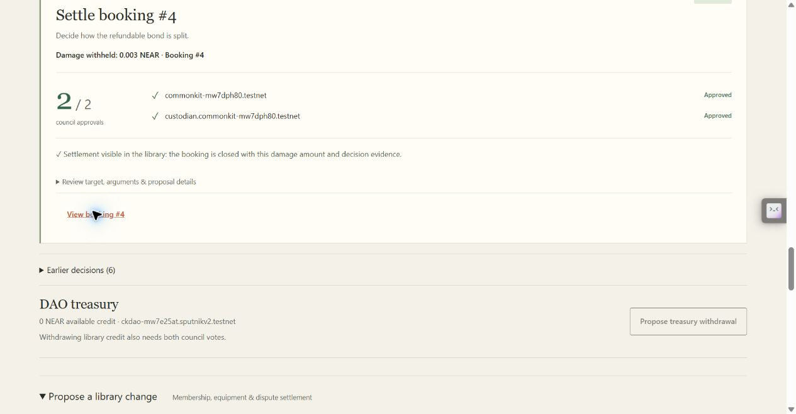
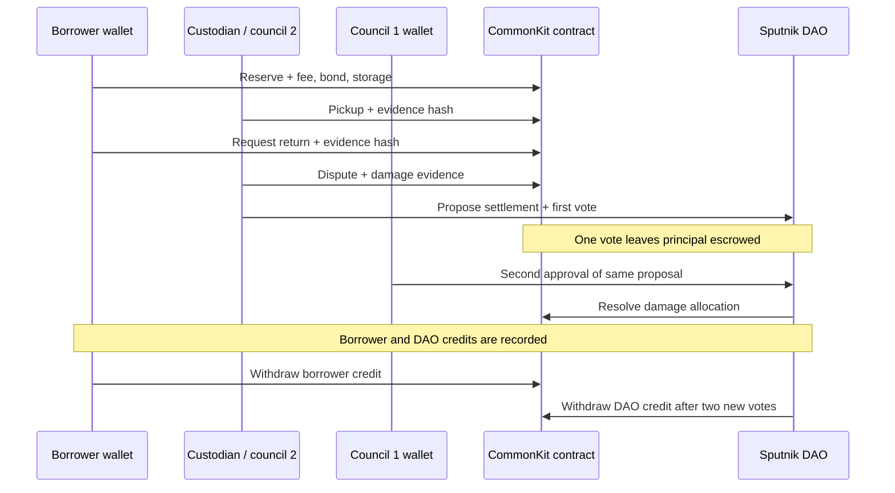

# CommonKit

**Borrow community equipment, escrow a refundable bond, and resolve damage disputes with two council votes on NEAR.**

Campus clubs share cameras and projectors, but handovers and deposit disputes often depend on one organizer's spreadsheet. CommonKit records reservations and evidence hashes, separates borrower and custodian permissions, and makes the community's DAO authorize contested damage allocations. Settlement creates credits; separate withdrawals transfer funds.

**Status:** working NEAR testnet prototype. The polished frontend completed an eleven-transaction Meteor Web rehearsal on 8 November 2026. Repository visibility is private during preparation; it must become public before hackathon submission. MIT licensed.

[Live demo](https://commonkit-testnet.muthukumarank.chatgpt.site) · [Wallet guide](https://commonkit-testnet.muthukumarank.chatgpt.site/demo-guide.html) · [Three-minute demo script](docs/DEMO-SCRIPT.md) · [Vercel setup](docs/VERCEL.md) · [Submission checklist](docs/SUBMISSION.md)

## Try it: do this, see this

No wallet is needed to inspect recorded testnet state.

| Do this | See this |
| --- | --- |
| Open the demo in Chrome | The live camera kit and borrower / custodian / council account roles. |
| Select booking **#4** | Pickup, return request, council review and settlement in its timeline. |
| Inspect settlement proposal **#6** | Two named approvals, 0.003 NEAR damage, and matching closed library state. |
| Inspect treasury proposal **#7** and accounting | The recorded run ended with 0.044 NEAR deposited and withdrawn; zero escrow, credits or pending transfers. |
| Read the [one-vote snapshot](docs/testnet/meteor-polished-single-vote.json) | Booking disputed, proposal pending, 0.011 NEAR still escrowed, zero credits before vote two. |
| Open the [eleven receipt hashes](docs/testnet/meteor-polished-receipts.txt) | Actual reserve, pickup, return, dispute, proposal, vote and withdrawal transactions. |

The shared testnet state changes with later demos. Historical booking allocations differ from current aggregate balances. The frontend verifies final execution and child receipts, not just wallet acceptance or DAO approval.

To perform actions, use **Connect Meteor → Meteor Web** and select an authorized testnet account in Meteor's connection prompt. The operator controls the recorded demo accounts; their keys are not in this repo. Visitors can inspect state but cannot borrow until the DAO admits their account or vote without a council seat. Follow the [wallet guide](app/public/demo-guide.html) for a new cycle.



## What NEAR does

The Rust library contract enforces admission, reservations, custody, evidence binding and integer accounting. Native testnet NEAR funds escrow. An existing **Sputnik DAO** is the governance authority: both council accounts must approve a FunctionCall proposal before the DAO can call `resolve`. Treasury withdrawal needs a separate two-vote proposal. **Meteor Web through NEAR Connect** supplies actual wallet identities.



| Component | Testnet account |
| --- | --- |
| Library | `library.ckdao-mw7e25at.testnet` |
| Sputnik DAO | `ckdao-mw7e25at.sputnikv2.testnet` |
| Borrower | `borrower.commonkit-mw7dph80.testnet` |
| Custodian / council 2 | `custodian.commonkit-mw7dph80.testnet` |
| Council 1 | `commonkit-mw7dph80.testnet` |

Public identifiers: [deployment.json](app/public/deployment.json). Deployed Wasm hash and validation: [VALIDATION.json](docs/VALIDATION.json).

## Run from a fresh clone

The testnet frontend needs **Node.js 24** and internet access. Reading the existing deployment needs neither Rust nor a private key.

```sh
git clone https://github.com/MUTHUKUMARAN-K-1/commonkit.git
cd commonkit
npm ci
npm run dev
```

Open **http://127.0.0.1:4318**. While private, cloning requires an invited GitHub account. No environment variables are required. RPC reads are public; signing uses your browser wallet.

```sh
npm test
npm run build:vercel
npm run preview
```

The deployable output is `dist/`. [vercel.json](vercel.json) sets Vite, `npm ci`, `npm run build:vercel` and `dist`; package engines select Node 24. Import the **repository root**, not `app/`, into Vercel. Configuration is prepared; no Vercel deployment was requested. See [VERCEL.md](docs/VERCEL.md).

## Contract and simulator checks

Use Rust **1.95.0** and the Wasm target. These checks do not submit chain transactions:

```sh
rustup toolchain install 1.95.0 --profile minimal --target wasm32-unknown-unknown
cargo +1.95.0 test -p commonkit-core --locked
cargo +1.95.0 build -p commonkit-core --locked
npm run test:api
npm start
```

The optional simulator runs at **http://127.0.0.1:4317** with simulated identities, clock and payments; its memory resets when stopped. The testnet frontend is `app/`; the original simulator is `web/`.

Build the contract in PowerShell with `npm run build:contract`, or on macOS/Linux:

```sh
RUSTFLAGS='--cfg near' cargo +1.95.0 build -p commonkit-contract --target wasm32-unknown-unknown --release --locked
```

Output: `target/wasm32-unknown-unknown/release/commonkit_contract.wasm`. Deployment is separate. `deploy:dao` and `setup:dao` are operator scripts requiring the private local account configuration, not fresh-clone commands. They send transactions and are excluded from CI. For your own instance, create your own funded testnet identities and Sputnik DAO, deploy and initialize the library with that DAO, then update the public deployment configuration.

## Validation and accounting

- 14 Rust lifecycle tests: authorization, overlap, settlement, callback restoration and replay behavior.
- 15 JavaScript tests: DAO binding, receipt finality/failures and presentation state.
- Local API integration: normal return, failed-withdrawal recovery and origin rejection.
- [Meteor rehearsal](docs/testnet/METEOR-POLISHED-REHEARSAL.md): booking #4, settlement #6, treasury #7, eleven final receipts independently verified by RPC.
- [GitHub Actions](.github/workflows/ci.yml): JS tests, static build checks, Rust tests, API integration and Wasm compilation without wallet credentials.

Camera deposit: **0.111 testnet NEAR = 0.001 fee + 0.01 refundable bond + 0.1 retained storage**. With 0.003 damage, settlement allocates 0.007 to the borrower and 0.004 to the DAO. A proposal separately attaches a 0.01 NEAR bond. Gas, proposal bonds and retained storage are outside the principal ledger:

`deposited principal = escrow + available credits + pending transfers + withdrawn principal`

Evidence files stay local; only SHA-256 hashes go on-chain. The rehearsal fixtures are synthetic, not proof of physical events.

## Hackathon development and reuse disclosure

Proposed track: **Social Money** for community-controlled equipment access and disputes. NEAR and Sputnik provide actual escrow and collective authorization. No NFTs, mainnet deployment or independent human council governance are claimed.

The archived v0.1 README is dated 7 November 2026 and already contained the Rust state machine, local simulator, draft contract and unsigned DAO adapter. [baseline-v0.1](https://github.com/MUTHUKUMARAN-K-1/commonkit/tree/baseline-v0.1) preserves that source. It is an import snapshot committed during repository preparation, not original commit history or a claim that it predates the hackathon.

Subsequent work adds deployed testnet contracts, real Sputnik proposals/votes, Meteor signing with final receipt checks, the public frontend and role/progress displays, lifecycle evidence and deployment documentation. Review the [baseline-to-submission-ready diff](https://github.com/MUTHUKUMARAN-K-1/commonkit/compare/baseline-v0.1...submission-ready). The tag marks this prepared snapshot; later changes remain visible on `main`.

Reuse: `near-sdk` and `borsh` for contracts; `serde` / `serde_json` for state; `near-kit` for RPC/operator scripts; `@hot-labs/near-connect` for wallets; Vite for builds; Playwright for local checks; and Sputnik DAO on testnet. Versions are locked and dependencies retain their licenses. AI coding assistance was used for implementation, review, documentation and test orchestration; the user directed the product and authorized wallet activity.

## Limits and source layout

This bounded prototype supports 32 assets, 64 admitted members and 256 lifetime booking records, without archival. An inactive or colluding council can block fair settlement; both demo council accounts belong to the operator. Evidence hashes cannot establish physical truth. Testnet success does not replace exhaustive receipt failure, capacity or gas/storage tests. See the [threat model](docs/THREAT-MODEL.md).

| Path | Purpose |
| --- | --- |
| `app/` | Public testnet frontend and browser wallet integration |
| `core/` | Shared Rust state machine and lifecycle tests |
| `contract/` | NEAR contract wrapper and transfer callbacks |
| `scripts/` | Tests, build checks and operator tooling |
| `docs/testnet/` | Public transaction/state evidence |
| `web/`, `server.mjs` | Original local simulator |

Private account files, build output, local research and the separate Sites hosting checkout are excluded. Production bundles exclude the optional development signer. License: [MIT](LICENSE).
